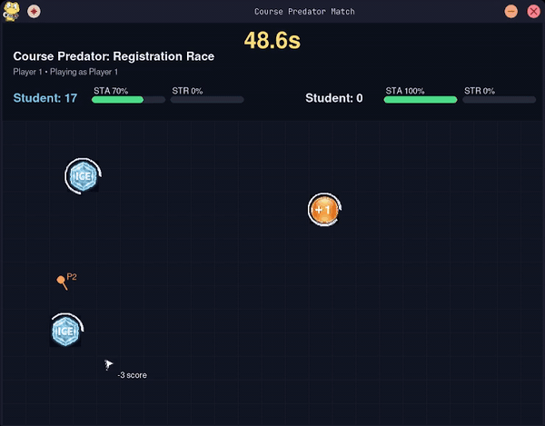

# Course Predator

A fast-paced 1v1 reaction game about the most stressful moment of every semester: **course registration**.

Two players race around the screen clicking shapes, managing stamina and stress, and trying to finish with the highest score before the timer runs out. Miss a shape and you lose points. Get too stressed and your cursor starts fighting you. Spend all your stamina and you go dark until it recovers.

The Python server is authoritative — clients only send input, while the server owns scoring, timing, visibility, and the final result. What you see is always what the server says happened.



*A 25-second clip of a match. The full recording lives in [`assets/full_replay.mp4`](assets/full_replay.mp4).*

## How it works

Every match is a short sprint (60 seconds by default, configurable from 15 to 300). Shapes spawn constantly on the field, and you click them for points — but not every shape is what it looks like, and your own resources matter as much as your aim.

### Shapes

| Shape | What it does |
| --- | --- |
| **Positive** (yellow) | Worth +1 to +6 points. Click it before it disappears. |
| **Negative** (red) | Worth −1 to −3 points. Avoid these — or click them with a shield active to negate the penalty. |
| **Shield** | Grants 5 seconds of protection. While shielded, negative shapes cost you nothing. |
| **Ice** | Freezes the current leader for 3 seconds. A great way to buy yourself breathing room. |
| **Illusion** | A fake shape that only *you* can see. Clicking it scores nothing but still drains stamina and adds stress. They spawn more often when your stress is high. |

### Stamina and stress

These two bars are the heart of the game:

- **Stamina** starts at 100. Every click costs 5. When you stop clicking for a moment, it regenerates on its own. Drop to 10 or below and you're **exhausted** — you can't click until it recovers, and the screen goes dark.
- **High stamina is a superpower.** At 90+ stamina, positive shapes score double and negative shapes only half-punish you. Your stress also recovers faster.
- **Stamina loss has a hidden cost.** Below 60, shapes start disappearing from *your* view only. At 10 or below, you're basically blind and helpless.
- **Stress** builds up as you play. A little stress slows your cursor down. Past 51 it slows you further, makes your cursor jump around on its own, and starts spawning illusions. Keep it in check by clicking positive shapes with high stamina.

### Controls

- Move the mouse to aim your virtual cursor (there's a one-time calibration on first run — just move in a circle for a second).
- **Left click** to grab a shape.
- **Esc** to quit the match.

The cursor is virtual and server-validated, so the server always decides what your click actually hit.

## Quick start

### Requirements

- Python 3.11+
- A desktop environment with a display (for the Pygame client)
- Network access to the server's TCP port, if playing remotely

### Install

```bash
git clone https://github.com/AradPilevarJavid/course_predator.git
cd course_predator

python3 -m venv .venv
source .venv/bin/activate        # Windows: .venv\Scripts\activate

pip install --upgrade pip
pip install -r requirements.txt
pip install -e .
```

On a headless server (no display), install the dependencies only — the server itself doesn't need a screen. Just don't try to launch the client there.

### Play a local match

Terminal 1 — start the server:

```bash
python run_server.py --host 127.0.0.1 --port 50007 --duration 60
```

Terminal 2 and 3 — start two clients (same machine or two machines on the same network):

```bash
python run_client.py
```

In each client's lobby, enter the same host and port, then click **Join Game**. Once two players have joined, the match starts automatically.

> **Tip:** **Host Game** in the lobby spins up a local server for you and connects the first client — handy for development, not for playing with friends over the internet.

## Playing with someone over the internet

1. The server owner runs the server on a VPS or any machine that's reachable from the internet:

   ```bash
   python run_server.py --host 0.0.0.0 --port 50007
   ```

2. Both players open the lobby, enter the server's public IP or DNS name (not `127.0.0.1`!), and the same port.

3. Both click **Join Game**. The match begins when enough players are in.

**Don't use `127.0.0.1` or `localhost` for remote play.** Those always mean "this computer" — each player would end up on their own machine instead of your server. The default is local on purpose, for safe development.

The default port is `50007`. Pick a different one with `--port`, and make sure your firewall allows traffic on that exact TCP port.

## Locking the room with a token

If you're running a public-facing server and want to keep random people out, set a shared room token:

**Server:**
```bash
export COURSE_PREDATOR_ROOM_TOKEN='pick-a-long-random-string'
python run_server.py --host 0.0.0.0 --port 50007
```

**Each client:**
```bash
export COURSE_PREDATOR_ROOM_TOKEN='pick-a-long-random-string'
python run_client.py
```

This is simple access gating, not real authentication. Anyone who knows the token can join, so use something long and random, and change it between sessions.

## Deploying on a VPS

There's a systemd unit template at [`deploy/course-predator.service`](deploy/course-predator.service). It's a starting point, not a one-click deploy — you'll need to:

1. Create a dedicated non-root user and an app directory (e.g. `/opt/course-predator`).
2. Copy the repo there and install dependencies in a virtualenv.
3. Drop the unit file into `/etc/systemd/system/`, fix the placeholder paths and username, and put your room token in an environment file only the service can read.
4. Open only the game port in your firewall:

   ```bash
   sudo ufw allow 50007/tcp
   sudo ufw enable
   ```

5. Start it up:

   ```bash
   sudo systemctl daemon-reload
   sudo systemctl enable --now course-predator
   sudo journalctl -u course-predator -f
   ```

**Why does the server restart between matches?** After a room finishes, saves its replay, and everyone disconnects, the server exits cleanly. systemd starts it fresh for the next room. You'll see a normal stop/start in the journal between matches — that's expected, not a crash.

No VPS is included or tested by this repo. You'll need to verify DNS, firewall rules, the token, and two real clients yourself.

## Spectating and replays

- **Spectate** from the lobby to watch a live match as a third party. Spectators see every shape, including ones hidden from the players.
- Every finished match is saved as a JSON file in `replays/`. Click **Watch Replay** in the lobby to play back the most recent one (Esc or Enter returns to the lobby).

## Configuration

Settings resolve in this order: **environment variable → `config.json` → defaults in `constants.py`**.

| Env var | Default | What it does |
| --- | --- | --- |
| `COURSE_PREDATOR_HOST` | `127.0.0.1` | Server bind address |
| `COURSE_PREDATOR_PORT` | `50007` | TCP port |
| `COURSE_PREDATOR_DURATION` | `60` | Match length in seconds (15–300) |
| `COURSE_PREDATOR_MIN_PLAYERS` | `2` | Players needed to start |
| `COURSE_PREDATOR_MAX_PLAYERS` | `4` | Max players (1v1 is the supported mode) |
| `COURSE_PREDATOR_REPLAY_DIR` | `replays` | Where replay files are written |
| `COURSE_PREDATOR_ROOM_TOKEN` | *(empty)* | Optional shared access token |
| `COURSE_PREDATOR_LOG_LEVEL` | `INFO` | Server log verbosity |
| `COURSE_PREDATOR_CONFIG` | `config.json` | Path to a config file |

You can also pass `--host`, `--port`, `--duration`, `--room-token`, and `--log-level` directly on the command line.

## Troubleshooting

| Problem | Fix |
| --- | --- |
| **Connection refused** | Is the server running? Does the host/port match? Is the firewall open on that TCP port? |
| **Players end up in different games** | Someone is probably using `127.0.0.1`/`localhost` for a remote server. Use the real address. |
| **Stuck on "Waiting for players"** | Both clients must click **Join Game** (not Host), with the same address, port, and token. |
| **Token rejected** | Make sure `COURSE_PREDATOR_ROOM_TOKEN` is identical on the server and both clients, then restart the client. |
| **Opponent left mid-match** | The match ends immediately and the remaining player wins. The replay is saved once the room empties. |
| **No replay file** | Check the server's replay directory and journal for permission errors. |
| **Client won't open on Linux** | You need a real desktop session with SDL/Pygame display support. The server itself is headless. |

## Development

```bash
make test        # or: python -m pytest
make lint        # or: python -m ruff check .
make format      # or: python -m black .
```

The GitHub Actions workflow runs tests, Ruff, and Black on every push and pull request.

Project layout at a glance:

```
course_predator/
├── game.py          # authoritative game rules
├── server.py        # threaded TCP server
├── protocol.py      # newline-delimited JSON messages
├── replay.py        # replay recording/loading
├── models.py        # shapes, players, shared state
├── config.py        # env/file/default configuration
└── client/
    ├── lobby.py     # pre-match lobby UI
    ├── game.py      # match loop
    ├── renderer.py  # Pygame drawing
    ├── network.py   # client-side networking
    ├── mouse.py     # virtual cursor + calibration
    └── replay.py    # replay playback
```

## What's not included

This repo ships the game and its server. There's no browser build, no accounts, no matchmaking, and no hosted public server. See [`ROADMAP.md`](ROADMAP.md) for what's planned next.

## License

Released under the [MIT License](LICENSE).
